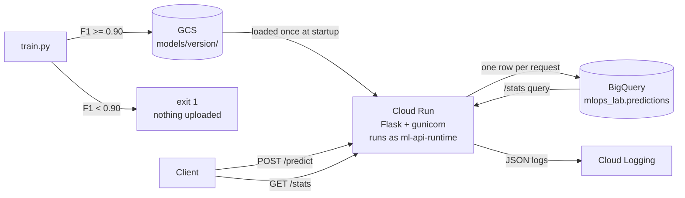
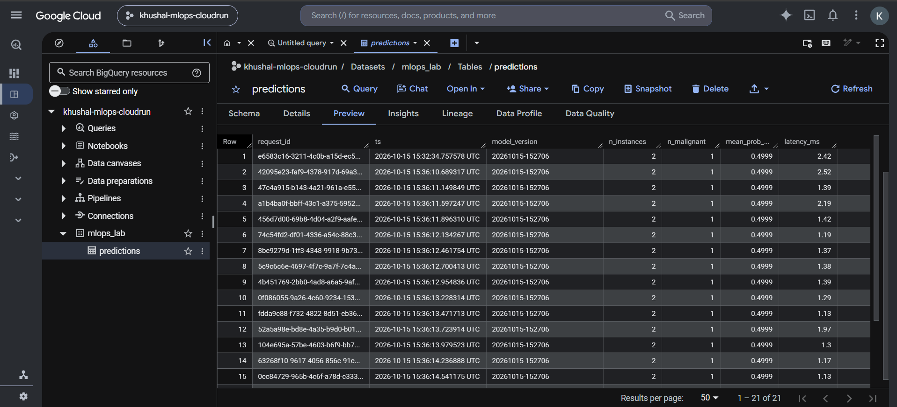
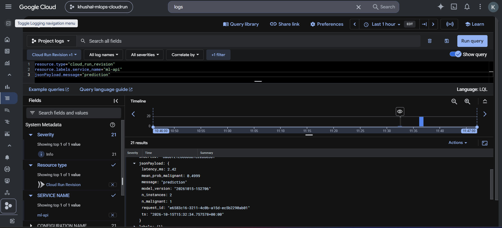
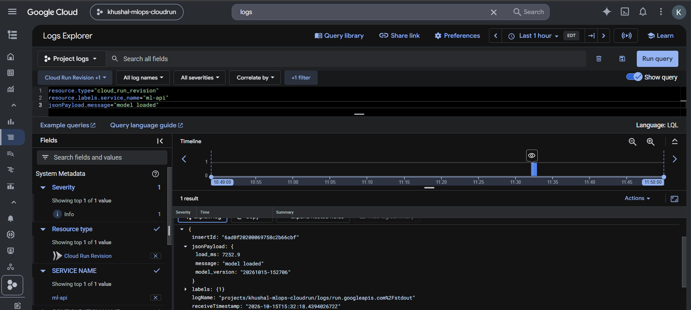
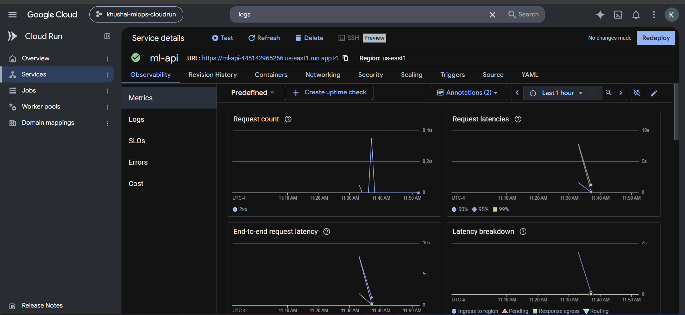
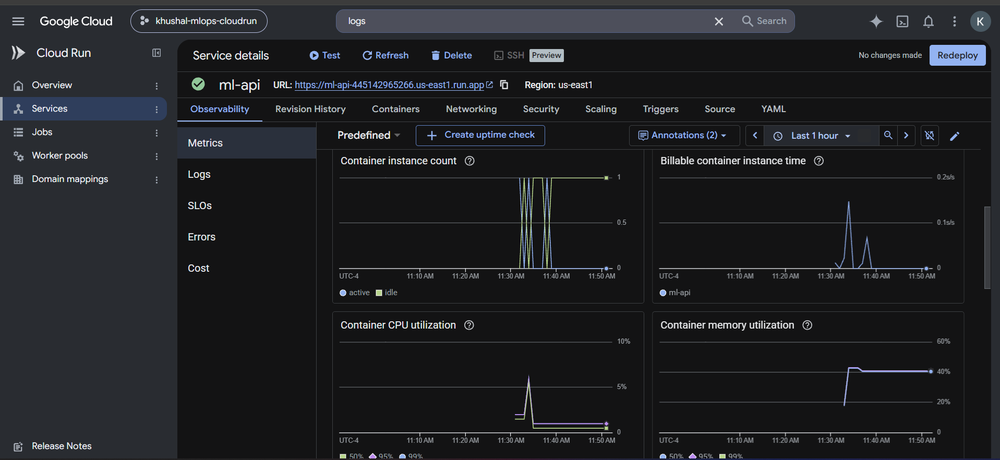
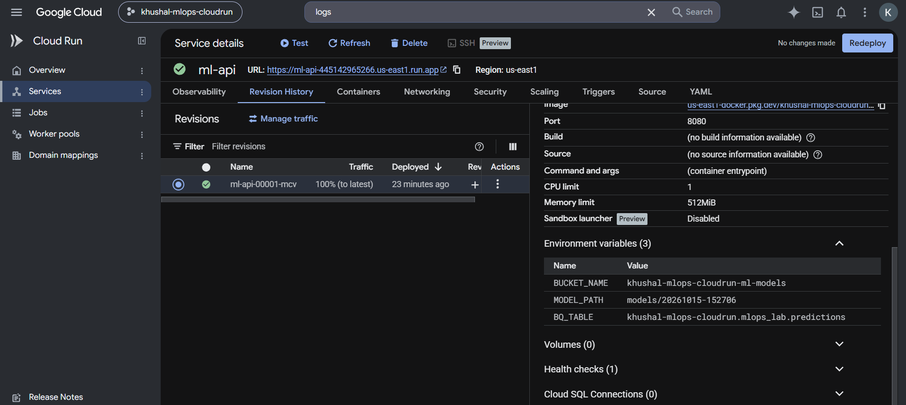
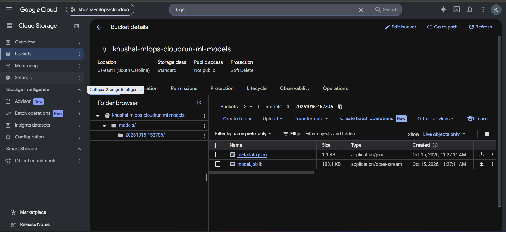

# Cloud Run Lab: ML Model Serving with GCS and BigQuery

Modified version of the [Cloud Run Intermediate Lab](https://github.com/raminmohammadi/MLOps/tree/main/Labs/GCP_Labs/Cloud_Runner_Labs/Intermediate_Lab) from the course repo.

The original lab deploys a Flask app with two demo endpoints: `/upload` writes `hello.txt` to Cloud Storage, and `/query` returns the top baby names in Texas from a public BigQuery dataset. This version uses the same services for actual model serving. Cloud Storage holds a versioned model, every prediction is logged to BigQuery, and `/stats` reads that log back as live serving metrics.

**Live service:** https://ml-api-445142965266.us-east1.run.app

## Architecture



## What changed from the original

| Area | Original lab | This version |
|---|---|---|
| App purpose | `/upload` writes `hello.txt`, `/query` returns top Texas names | `/predict` serves a breast-cancer classifier, `/stats` reports live serving metrics |
| Cloud Storage | Stores a demo text file | Model registry: one folder per model version, loaded at startup |
| BigQuery | Queries a public dataset | Prediction log with one row per request, read back by `/stats` |
| Model | None | GradientBoosting on sklearn breast cancer data, F1 quality gate at 0.90 |
| Image registry | `gcr.io` Container Registry | Artifact Registry |
| Build | Local `docker build` | Cloud Build (`gcloud builds submit`), no local Docker needed |
| Service account roles | Storage Admin on the whole project | Read-only on one bucket, write on one table, permission to run queries |
| Input handling | None | Checks for valid JSON, numeric values, 30 features and 1-100 rows; bad input returns 400 |
| Logging | Plain text | Single-line JSON that Cloud Logging parses into searchable fields |
| Configuration | Bucket name only | `BUCKET_NAME`, `MODEL_PATH`, `BQ_TABLE`; each revision is pinned to one model version |
| Dependencies | Unpinned (repo) / 2021 versions (README) | Pinned, identical for training and serving |
| Container | Python 3.8 / 3.9 (end of life), runs as root | Python 3.11-slim, non-root user, gunicorn on `$PORT` |

### Issues found in the original lab

1. Step 3 pushes to `gcr.io`, but Container Registry no longer accepts pushes, so the lab fails as written.
2. The README Dockerfile (Python 3.8, Flask dev server via `python app.py`) does not match the repo Dockerfile (Python 3.9, gunicorn).
3. The repo Dockerfile runs `apt-get install -y` with no package names, which adds an empty layer.
4. gunicorn binds to a hardcoded `8080` instead of the `$PORT` that Cloud Run provides.
5. Storage Admin on the project lets the service delete any bucket, far more access than it needs.
6. `/upload` writes data on a GET request.
7. The folder-level README describes a "Cloud Runner" CLI (`cloud-runner auth login`) that does not exist, and its install link points to example.com.

## Results

**Model** (stratified 80/20 split, `random_state=42`):

| Accuracy | Precision | Recall | F1 | ROC-AUC |
|---|---|---|---|---|
| 0.9561 | 0.9467 | 0.9861 | 0.966 | 0.9907 |

Quality gate check: `F1_THRESHOLD=0.99 python train.py` prints `QUALITY GATE FAILED` and exits with code 1, so a weak model never gets saved or uploaded.

**Live service** (revision `ml-api-00001-mcv`, model `20261015-152706`):

| Check | Result |
|---|---|
| `/predict` on the 2 sample rows | malignant (0.9997), benign (0.0002), same as the local run |
| Prediction latency inside the handler, 21 requests | avg 1.54 ms, p95 2.42 ms |
| Requests logged to BigQuery | 21 of 21 |
| Model load on cold start (`load_ms`) | 7252.9 ms |
| Container instances | 1 for all requests (concurrency limit 40) |
| Memory use | about 40% of 512 MiB |
| CPU use | peak about 6% |
| Model in GCS | 183.1 KB, bucket not public |

**Observations**

- **Cold start time is startup work, not prediction.** Loading took 7.25 s: importing the GCS client, authenticating, downloading the model and loading scikit-learn on 1 vCPU. A prediction takes 1-2 ms. The latency chart shows the same pattern: one spike of about 7 s on the first request, then near zero.
- **512 MiB is the right memory size.** Usage sits around 205 MiB. At 256 MiB the container would run near its limit.
- **One request can be traced end to end.** The `request_id` returned by the first live `/predict` call (`e6583c16-3211-4c0b-a15d-ec5b2290ab01`) appears in the Cloud Logging entry and in the BigQuery row.
- **Rollback needs no rebuild.** Each revision stores its own `MODEL_PATH`, so moving traffic back to an older revision restores the older model.

## Screenshots

| | |
|---|---|
| Predictions logged in BigQuery |  |
| Structured JSON log fields |  |
| Model load time on cold start |  |
| Request count and latency |  |
| Instances, CPU and memory |  |
| Revision pinned to a model version |  |
| Versioned model in a private bucket |  |

## Endpoints

| Method | Path | Returns |
|---|---|---|
| GET | `/` | Model version and test metrics |
| GET | `/health` | Liveness check |
| POST | `/predict` | `{"instances": [[30 floats], ...]}` → label and malignant probability per row |
| GET | `/stats` | Last 24 hours from BigQuery: requests, malignant rate, avg/p95 latency per model version |

```bash
curl https://ml-api-445142965266.us-east1.run.app/health
curl -X POST https://ml-api-445142965266.us-east1.run.app/predict \
  -H "Content-Type: application/json" -d @sample_request.json
curl https://ml-api-445142965266.us-east1.run.app/stats
```

## Repo layout

```
app.py               Flask service: model loading, /predict, /stats, JSON logging
train.py             Training, F1 quality gate, upload to GCS
requirements.txt     Pinned versions shared by training and serving
Dockerfile           Python 3.11-slim, non-root user, gunicorn on $PORT
bq_schema.json       Schema of the prediction log table
sample_request.json  Two real test rows for curl
.dockerignore        Keeps the venv and local model out of the image
.gcloudignore        Keeps the same files out of the Cloud Build upload
screenshots/         Verification screenshots
```

## Reproduce

Run in Git Bash (Windows) or a terminal (Mac/Linux). Requires the gcloud CLI and Python 3.11.

```bash
export PROJECT_ID=<your-project-id>
export REGION=us-east1
export BUCKET_NAME=${PROJECT_ID}-ml-models
export PROJECT_NUMBER=$(gcloud projects describe $PROJECT_ID --format="value(projectNumber)")
export RUNTIME_SA=ml-api-runtime@${PROJECT_ID}.iam.gserviceaccount.com
export IMAGE=${REGION}-docker.pkg.dev/${PROJECT_ID}/ml-repo/ml-api
```

**1. Train and test locally**
```bash
python -m venv .venv && source .venv/Scripts/activate   # Mac/Linux: source .venv/bin/activate
pip install -r requirements.txt
python train.py
LOCAL_MODEL_DIR=model python app.py
# in a second terminal:
curl -X POST localhost:8080/predict -H "Content-Type: application/json" -d @sample_request.json
```

**2. Enable APIs and create resources**
```bash
gcloud config set project $PROJECT_ID
gcloud services enable run.googleapis.com artifactregistry.googleapis.com cloudbuild.googleapis.com \
  storage.googleapis.com bigquery.googleapis.com iam.googleapis.com compute.googleapis.com
gcloud storage buckets create gs://$BUCKET_NAME --location=$REGION --uniform-bucket-level-access
gcloud artifacts repositories create ml-repo --repository-format=docker --location=$REGION
bq mk --dataset --location=US ${PROJECT_ID}:mlops_lab
bq mk --table ${PROJECT_ID}:mlops_lab.predictions bq_schema.json
```
The Compute Engine API creates the default service account that Cloud Build uses. No VM is created.

**3. Runtime service account with minimal roles**
```bash
gcloud iam service-accounts create ml-api-runtime --display-name="ML API runtime"
gcloud storage buckets add-iam-policy-binding gs://$BUCKET_NAME \
  --member=serviceAccount:$RUNTIME_SA --role=roles/storage.objectViewer
gcloud projects add-iam-policy-binding $PROJECT_ID \
  --member=serviceAccount:$RUNTIME_SA --role=roles/bigquery.jobUser
bq add-iam-policy-binding --member=serviceAccount:$RUNTIME_SA \
  --role=roles/bigquery.dataEditor ${PROJECT_ID}:mlops_lab.predictions
gcloud projects add-iam-policy-binding $PROJECT_ID \
  --member=serviceAccount:${PROJECT_NUMBER}-compute@developer.gserviceaccount.com \
  --role=roles/cloudbuild.builds.builder
```

**4. Upload the model, build and deploy**
```bash
gcloud auth application-default login
python train.py --upload
export MODEL_VERSION=$(python -c "import json; print(json.load(open('model/metadata.json'))['version'])")

gcloud builds submit --tag ${IMAGE}:v1
gcloud run deploy ml-api --image ${IMAGE}:v1 --region $REGION \
  --service-account $RUNTIME_SA \
  --set-env-vars BUCKET_NAME=$BUCKET_NAME,MODEL_PATH=models/$MODEL_VERSION,BQ_TABLE=${PROJECT_ID}.mlops_lab.predictions \
  --memory 512Mi --cpu 1 --min-instances 0 --max-instances 3 --concurrency 40 \
  --allow-unauthenticated
```

## Cost

At lab scale everything stays inside the Cloud Run, Cloud Storage and BigQuery free tiers, apart from cents for BigQuery streaming inserts and image storage. With `--min-instances 0` the service scales to zero and costs nothing while idle, and `--max-instances 3` caps spending if traffic spikes.

## Cleanup

```bash
gcloud run services delete ml-api --region $REGION
gcloud artifacts repositories delete ml-repo --location=$REGION
gcloud storage rm -r gs://$BUCKET_NAME
bq rm -r -f -d ${PROJECT_ID}:mlops_lab
gcloud iam service-accounts delete $RUNTIME_SA
```

## Next steps

- GitHub Actions pipeline: train, run the gate, upload, build and deploy on every push, so a model below the F1 threshold never reaches production
- Startup CPU boost (`--cpu-boost`) to cut the 7 s cold start, measured before and after
- Drift monitoring on the BigQuery log, for example alerting when the malignant rate moves far from the training distribution